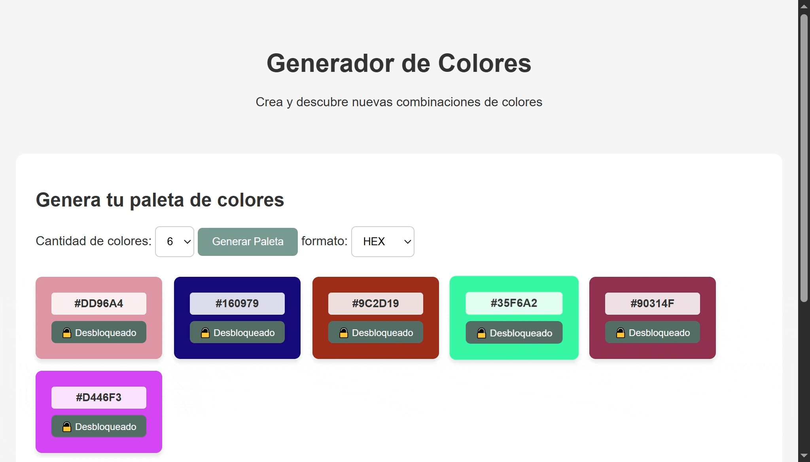

# 🎨 Generador de Colores

<h3 align="center">
  Crea y descubre nuevas combinaciones de colores
</h3>

  Una aplicación web interactiva y accesible para crear, explorar, bloquear y copiar paletas de colores personalizadas.

---

## 📑 Índice
- [✨ Características principales](#caracteristicas)
- [🛠️ Tecnologías y Herramientas](#tecnologias)
- [📸 Vista previa](#vista-previa)
- [🌐 Demo online](#demo)
- [👨‍💻 Autor](#autor)

---

<h2 id="caracteristicas">✨ Características principales</h2>

- 🎨 **Generación Inteligente:** Crea combinaciones de colores armónicas y equilibradas basadas en valores HSL aleatorios.
- 🔒 **Sistema de Bloqueo:** Bloquea tus colores favoritos para que no cambien al generar una nueva paleta.
- 🔄 **Cantidad Personalizable:** Elige cuántos colores deseas mostrar en pantalla (6, 8 o 9 tarjetas).
- 🔠 **Múltiples Formatos:** Visualiza y cambia instantáneamente el código del color entre **HEX**, **RGBA** y **HSL**.
- 📋 **Copiar al Portapapeles:** Copia automáticamente el código del color al hacer clic en su tarjeta, con retroalimentación visual inmediata.
- 👁️ **Contraste Automático:** Las tarjetas calculan de forma automática si el texto debe ser claro u oscuro según la luminosidad del fondo.
- ♿ **Accesibilidad:** Diseñado con soporte para foco visible y avisos por voz para lectores de pantalla.

---

<h2 id="tecnologias">🛠️ Tecnologías y Herramientas</h2>

### Lenguajes y Estilos
- **HTML5:** Estructura semántica de la página web (`<header>`, `<main>`, `<aside>`, `<footer>`).
- **CSS3:** Estilos personalizados, diseño con Flexbox y variables de diseño.
- **JavaScript (Vanilla):** Lógica de generación de colores, conversión de formatos (HEX, RGBA, HSL) y manipulación del DOM.

### Conceptos y APIs web aplicadas
- **Flexbox & Layout Responsivo:** Estructura adaptable para la visualización de tarjetas.
- **Clipboard API:** Copiado automático de códigos de color al portapapeles (`navigator.clipboard`).
- **Accesibilidad Web (A11y):** Uso de HTML semántico, manejo de focos visibles (`:focus-visible`) y atributos `aria-live`.
- **Vanilla JS:** Manipulación directa del DOM y lógica de conversión entre espacios de color (HSL, HEX, RGBA) sin dependencias externas.

### Entorno de Desarrollo
- **Visual Studio Code:** Editor de código fuente utilizado para el desarrollo.
- **Git / GitHub:** Control de versiones y alojamiento de repositorio.
- **GitHub Pages:** Herramienta para desplegar y publicar el proyecto en la web.

---
<h2 id="vista-previa">📸 Vista previa</h2>

> Así luce la aplicación funcionando en vivo:

---

<h2 id="demo">🌐 Demo online</h2>

- **Sitio web en vivo:** [Ver proyecto en funcionamiento](https://sanabriajesus04-jpg.github.io/ProyectoM1-Jes-s-Eduardo-Sanabria-Chacon/)

---

<h2 id="proximas-secciones">🚀 Próximas secciones a agregar</h2>

- [ ] Modo Oscuro / Claro para la interfaz de la aplicación.

---

<h2 id="autor">👨‍💻 Autor</h2>

**Jesus Eduardo Sanabria Chacon**
- GitHub: [@Sanabriajesus04-jpg](https://github.com/sanabriajesus04-jpg/ProyectoM1-Jes-s-Eduardo-Sanabria-Chacon)